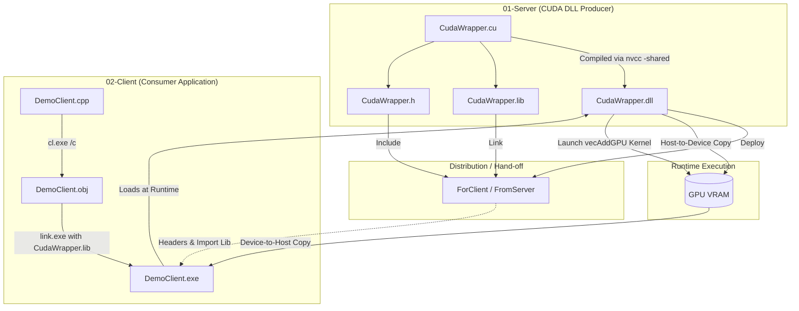

# CUDA Wrapper Library

[](LICENSE)
[](https://developer.nvidia.com/cuda-toolkit)
[](https://www.microsoft.com/windows)
[](https://isocpp.org/)

A modular Windows Dynamic Link Library (DLL) wrapper around NVIDIA CUDA kernel routines, developed for **System Programming & Operating Systems**.

This project decouples GPU computing logic (CUDA kernel management, device memory allocation, and data transfers) from consumer client applications. Client programs can consume high-performance GPU routines via standard C linkage (`extern "C"`) and MSVC without requiring the CUDA compilation toolchain (`nvcc`) in client build pipelines.

---

## Architecture Overview

The project is structured around a classic **Server-Client** dynamic linking model:



---

## Features

- **Decoupled Architecture**: Encapsulates CUDA memory management (`cudaMalloc`, `cudaMemcpy`, `cudaFree`) and grid/block launch configurations inside a reusable DLL.
- **Pure C Export Interface**: Uses `extern "C" __declspec(dllexport)` to prevent C++ name mangling, allowing broad compatibility with any language or runtime supporting native DLL bindings.
- **Micro-Benchmarking**: `DemoClient.cpp` includes high-precision timers (`helper_timer.h`) measuring:
  - CPU computation time
  - GPU initialization and host-to-device memory transfer
  - GPU pure computation (kernel execution)
  - GPU device-to-host transfer and resource cleanup
- **Validation**: Compares vector addition output between CPU and GPU with floating-point precision tolerance ($\epsilon = 10^{-6}$) over ~11.44 million elements (`11,444,777`).

---

## API Reference

The server exposes three core lifecycle functions declared in [`01-Server/ForClient/CudaWrapper.h`](01-Server/ForClient/CudaWrapper.h):

```c
#pragma once

// Allocates device memory and copies input vectors from host to device
extern "C" void InitDeviceData(float* hostInput1, float* hostInput2, int iNumberOfArrayElements);

// Configures grid/block dimensions and launches the vector addition kernel
extern "C" void RunVecAddKernel(int iNumberOfArrayElements);

// Copies result vector back to host memory and releases device memory
extern "C" void RetrieveDeviceDataAndCleanup(float* hostOutput, int iNumberOfArrayElements);
```

### Execution Lifecycle

1. **`InitDeviceData`**: Allocates memory on the GPU for two input arrays and one output array (`cudaMalloc`), then copies host input buffers to GPU memory (`cudaMemcpyHostToDevice`).
2. **`RunVecAddKernel`**: Dispatches the `vecAddGPU` kernel across 1D thread blocks (256 threads per block, grid size determined by $\lceil N / 256 \rceil$).
3. **`RetrieveDeviceDataAndCleanup`**: Transfers computed results from device memory back to the host output buffer (`cudaMemcpyDeviceToHost`), followed by deallocation (`cudaFree`).

---

## Repository Structure

```text
CUDA_Wrapper_Library/
├── 01-Server/                     # DLL Server project
│   ├── CudaWrapper.cu             # CUDA source (kernel + exported DLL functions + DllMain)
│   ├── Build.bat                  # Compilation script using nvcc
│   └── ForClient/                 # Artifacts to distribute to clients
│       ├── CudaWrapper.h          # Export header
│       ├── CudaWrapper.lib        # Import library
│       └── CudaWrapper.dll        # Dynamic link library
├── 02-Client/                     # Benchmark Client project
│   ├── DemoClient.cpp             # Host application with CPU vs GPU benchmark
│   ├── helper_timer.h             # High-precision timer interface
│   ├── Build.bat                  # Compilation script using cl.exe & link.exe
│   └── FromServer/                # Staged server dependencies
│       ├── CudaWrapper.h
│       ├── CudaWrapper.lib
│       └── CudaWrapper.dll
├── LICENSE                        # MIT License
└── README.md                      # Project documentation
```

---

## Prerequisites

Before building, ensure the following are installed and added to your `PATH` on a Windows system:

1. **NVIDIA CUDA Toolkit** (includes `nvcc` and CUDA runtime headers/libraries).
2. **Microsoft Visual Studio** (or Visual Studio Build Tools) with the **Desktop development with C++** workload (provides `cl.exe` and `link.exe`).
3. An NVIDIA GPU with CUDA Compute Capability support.

> [!NOTE]
> All build commands should be executed from the **x64 Native Tools Command Prompt for VS**.

---

## Build & Execution Instructions

### 1. Build the CUDA Server DLL

Open the **x64 Native Tools Command Prompt**, navigate to the `01-Server` directory, and run `Build.bat`:

```cmd
cd 01-Server
Build.bat
```

This invokes:
```cmd
nvcc -shared -o CudaWrapper.dll CudaWrapper.cu
```

After compilation, copy the generated `CudaWrapper.dll`, `CudaWrapper.lib`, and `CudaWrapper.h` into `02-Client/` (or `02-Client/FromServer/`).

### 2. Build the Client Application

Navigate to the `02-Client` directory and run `Build.bat`:

```cmd
cd ..\02-Client
Build.bat
```

This compiles and links the client with MSVC:
```cmd
cl.exe /c /EHsc DemoClient.cpp
link.exe DemoClient.obj CudaWrapper.lib /SUBSYSTEM:CONSOLE
```

### 3. Run the Benchmark

Execute the client executable (ensure `CudaWrapper.dll` is in the same directory):

```cmd
DemoClient.exe
```

#### Sample Output

```text
Time taken for Vector Addition on CPU = 0.045120
Time taken by GPU for Memory/Transfer = 0.032150
Time taken by GPU for Pure Math = 0.003410
Time taken by GPU for Retrieval/Cleanup = 0.015240
Comparison of CPU and GPU Vector Addition is within accuracy of 0.000001
```

---

## Key Takeaways

- **Bandwidth vs. Compute**: While kernel execution (`Pure Math`) is orders of magnitude faster on the GPU than CPU execution, PCIe host-to-device and device-to-host memory copies account for the majority of overall GPU elapsed time.
- **Operating Systems & System Programming**: Illustrates explicit dynamic linking, runtime library loading, Windows PE DLL export/import mechanics, and memory management across distinct physical memory spaces (Host RAM vs. Device VRAM).

---

## License

This project is licensed under the [MIT License](LICENSE).
